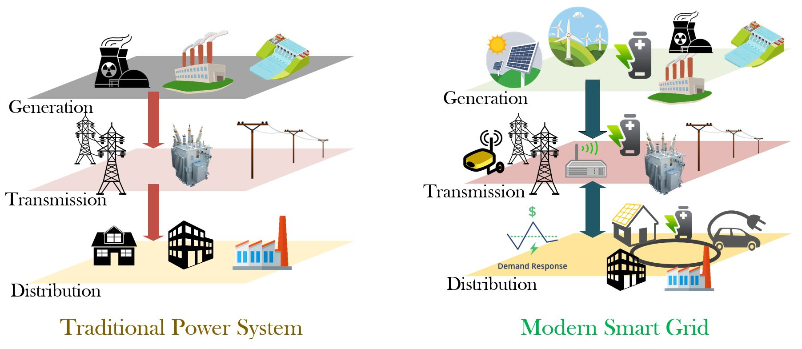
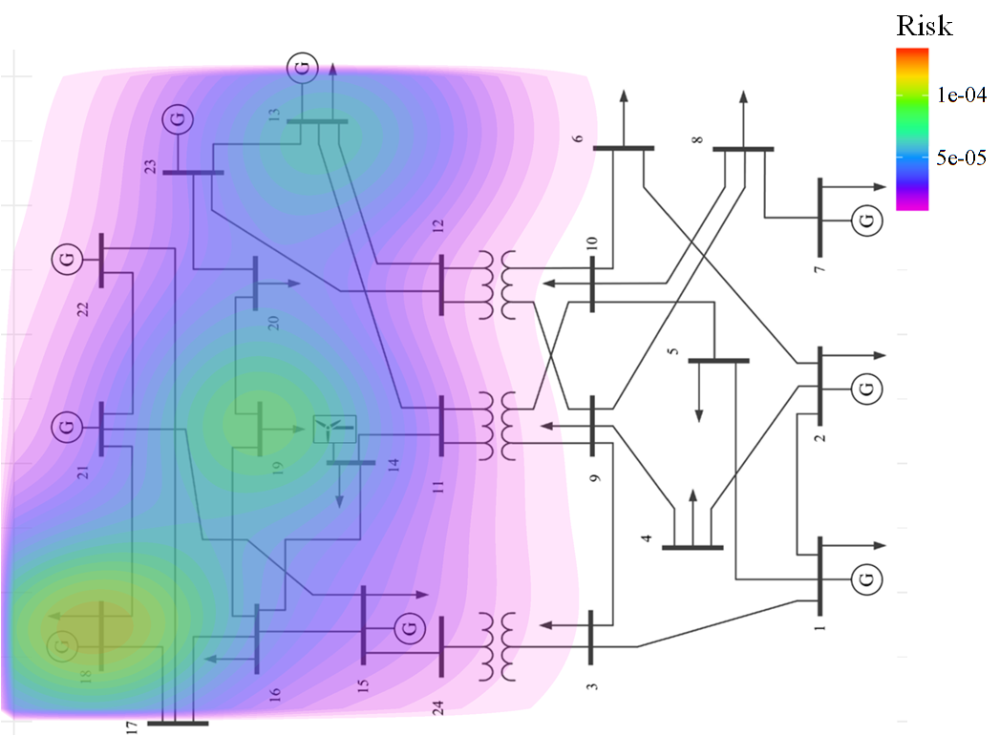

I am a Research Scientist at Amazon Web Services.

I received my Ph.D. and MSc. degree in electrical engineering from the University of Saskatchewan in 2021 and 2017, respectively. I worked in the Smart Grid and Energy Network (SMARTGEN) Lab at the University of Saskatchewan, under the supervision of Dr. C. Y. Chung. I received my Bachelor in electrical engineering degree from the National University of Sciences and Technology, Islamabad, Pakistan in 2015.

Research Interests
======
* Smart Grids
* Energy Storage Systems
* Power Systems Reliability and Security
* AI for Power Systems

